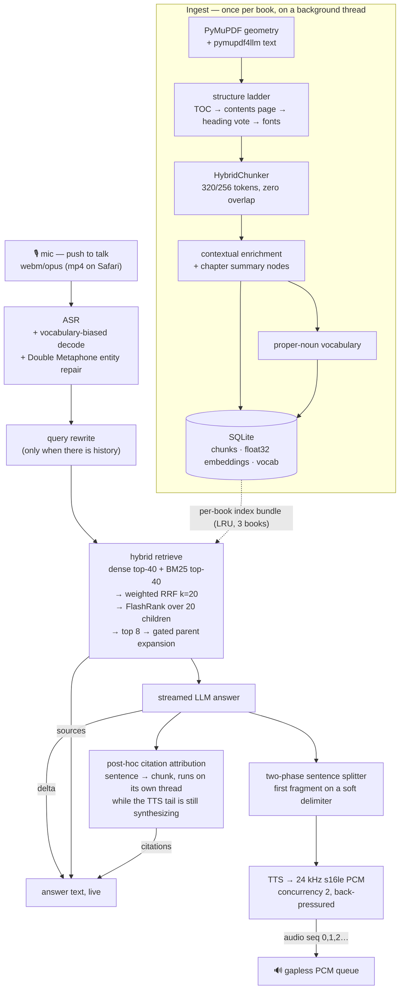

# BookTalk

Upload a PDF book, ask it a question out loud, and hear the book answer — grounded in
its own pages, with the passages it used shown on screen. The interesting part is not
that it works but *how fast* and *how honestly* it works: the answer starts being spoken
while the language model is still writing it, the retrieval that feeds it is a
hand-rolled hybrid pipeline (structure-aware chunks, dense + BM25 fusion, a 5 MB
cross-encoder rerank) with no RAG framework anywhere in the stack, and every *retrieval*
number in this README comes out of an ablation harness in `backend/eval/` that you can
re-run. Measured on a fixture book nobody has ever read: recall@1 **0.856 → 0.950** from
naive chunking to the full pipeline, and 100% correct refusals on questions the book does
not answer. The two first-audio numbers are the exception — **2.7 s** read off the API's
own `first_audio_ms` timing and **~3.9 s** observed in the browser, both by hand, neither
by the harness.

---

## How it works



The two things worth staring at: **TTS starts on the first fragment**, not the first
sentence and certainly not the finished answer — that is where time-to-first-audio comes
from. And **citations are computed after the answer exists**, off the critical path, so
provenance costs nothing in latency and the spoken text never reads "(Chapter 7)" aloud.

Depth: [docs/ARCHITECTURE.md](docs/ARCHITECTURE.md).

---

## Quickstart

Python ≥ 3.9 (developed against the stock macOS `python3` 3.9.6) and Node ≥ 18.

**Backend**

```bash
cd backend
python3 -m venv .venv && source .venv/bin/activate
pip install -e '.[dev]'
cp .env.example .env          # then add your OPENAI_API_KEY
uvicorn app.main:app --port 8000
```

**Frontend** (second terminal)

```bash
cd frontend
npm install
npm run dev                   # http://localhost:5173, proxies /api to :8000
```

Once both are installed, `./scripts/dev.sh` from the repo root runs the two servers in one
terminal (backend with `--reload` on `:8000`, Vite on `:5173`) and Ctrl-C stops both.

**No API key?** `npm run mock` starts a canned backend on `:8000` that implements the
whole API contract — library, ingest progress, SSE stream, PCM audio — so the UI is fully
drivable offline. The real backend also boots without a key: it serves, reports
`openai_configured: false` on `/api/health`, and returns an actionable 503 from the
endpoints that need a model.

**Tests and eval**

```bash
cd backend && .venv/bin/python -m pytest        # 369 offline tests, no network
cd frontend && npm run test && npm run build    # 11 vitest units, zero-error tsc

cd backend
.venv/bin/python eval/make_fixture_book.py      # regenerate the fixture + golden set
.venv/bin/python eval/run_eval.py --fake \
  --report /tmp/fake.md --results /tmp/fake     # offline plumbing check, no key
.venv/bin/python eval/run_eval.py               # the real six-arm ablation
```

`run_eval.py` writes to `eval/report.md` and `eval/results/` by default, so a bare
`--fake` run silently overwrites the committed real-model numbers with fake ones — hence
the `--report`/`--results` redirect above.

---

## Deploying a public demo

The root `Dockerfile` builds one image — the FastAPI backend serving the built
frontend on port 7860 — and boots with the five example books already indexed
(`deploy/seed/`, rebuilt by `python3 scripts/make_demo_seed.py`), so a fresh container
answers questions without spending anything on ingestion.

```bash
docker build -t booktalk .
docker run -p 7860:7860 -e OPENAI_API_KEY=... -e DEEPSEEK_API_KEY=... booktalk
```

The image sets `BOOKTALK_DEMO=1`: per-IP hourly limits and a global daily cap on
uploads, questions and voice input, a 20 MB upload limit, and the seeded books cannot be
deleted (`backend/app/demo.py`). `DEEPSEEK_API_KEY` is optional — when set, every chat
completion (answers, query rewrite, ingest enrichment) goes to `deepseek-chat`, while
embeddings, ASR and TTS stay on OpenAI, which DeepSeek does not offer. The hosted demo
runs on Render's free tier from `render.yaml` (a Blueprint: one Docker web service, the
two keys entered as secrets); peak memory measured under a 512 MB cap was ~340 MB with
three books loaded and a fourth ingesting. Free instances sleep after 15 idle minutes,
so the first visit after a while takes about a minute to wake up.

---

## Does the retrieval actually work?

`backend/eval/` builds a 25-page, 12-chapter fixture book about an archipelago that does
not exist, asks 88 questions derived from the same fact table the book was written from,
and runs six ablation arms that differ by exactly one thing each. Invented facts are the
point: no model has read about Kestrel Cove, so a correct answer is evidence that
*retrieval found the passage*, not that the model already knew.

Real models (`gpt-4o-mini` + `text-embedding-3-small`), reranker
`ms-marco-TinyBERT-L-2-v2`, RRF k=20, weights 0.5/0.5:

| Arm | Configuration | chunks | recall@1 | recall@3 | recall@5 | MRR | answer full | refusal ok |
|---|---|---|---|---|---|---|---|---|
| **A** naive | fixed 800-char chunks, dense only | 85 | 0.856 | 0.938 | 0.950 | 0.929 | 0.925 | 0.943 |
| **B** +structure | structure-aware chunks + breadcrumbs | 65 | 0.938 | 0.994 | 0.994 | 0.994 | 0.988 | 0.989 |
| **C** +hybrid | dense + BM25, weighted RRF | 65 | 0.950 | 0.988 | 0.994 | 1.000 | 0.975 | 0.977 |
| **D** +rerank | cross-encoder over the fused head | 65 | 0.950 | 0.975 | 0.994 | 1.000 | 0.975 | 0.977 |
| **E** +summaries | chapter synopsis nodes indexed | 78 | 0.950 | 0.975 | 0.988 | 1.000 | 0.950 | 0.977 |
| **F** +contextual | LLM situating context per chunk | 78 | 0.950 | 0.975 | 0.994 | 1.000 | 0.963 | 0.977 |

**Read recall@1 and MRR together, or you will misread both.** Recall@k here is the share of
a question's *gold chapters* present in the top k, and 8 of the 80 retrieval-scored
questions have two gold chapters — such a question can score at most 0.5 at k=1 even when
its first result is correct. In arms C–F every one of the 80 questions puts a gold chapter
at rank 1 (`first_rank == 1` for all 80, which is what MRR = 1.000 means); the 0.950 is
(72 × 1.0 + 8 × 0.5) / 80 exactly, and not four misses. What C–F still do not do is pull a
cross-chapter question's *second* chapter up, which is where the remaining headroom is.

Full tables — token-IoU, per-category breakdowns, first-hit rank distribution, the RRF
sweep — in [`backend/eval/report.md`](backend/eval/report.md), with the raw CSVs under
`backend/eval/results/`.

### What the aggregate hides

The headline row is the least interesting thing in the table. The per-category numbers
are where each technique shows up:

- **Thematic questions are what structure buys.** "What is chapter 7 about" has no
  keyword to hit. Chapter-summary recall@1 goes **0.500 → 0.917 → 1.000** across naive →
  +structure → +hybrid, and MRR **0.610 → 0.958 → 1.000**. Naive 800-char chunks miss
  these outright; breadcrumb-carrying chunks under a detected heading do not.
- **Cross-chapter synthesis is what breadcrumbs buy.** Questions that need two chapters
  retrieved go from **0.75 to 1.00** full-answer rate (every expected substring present)
  between arm A and arm B, and hold at 1.00 through arms C and D. The summary and
  contextual arms give a little of it back (E 0.75, F 0.875 on n=8): summary nodes
  compete with body chunks for the retrieval head on exactly these questions. At n=8 a
  single question moves the number by 0.125 — the per-question CSV is committed for
  anyone who wants the individual cases.
- **Not-in-book refusal is 8/8 in every arm.** In the other direction the shipped arm
  wrongly refuses 2 of the 80 answerable questions (best arms: 1). The reranker's
  confidence score looked like it separated the two cases — but only on part of the
  fixture: **0.98** on single-fact questions and **0.99** on ASR-corrupted ones against
  **0.003–0.038** on not-in-book ones, while in the same arm cross-chapter sat at **0.47**
  and chapter-summary at **0.50** (the summary arms lift chapter-summary back to 0.95 and
  leave cross-chapter at 0.47). That was already a narrower result than
  "0.98 on in-book questions", and on a real book the ordering inverted outright: *"what
  happens in chapter 2"* — answered correctly from four cited passages — scored
  **0.0017**, and a subject the book never mentions scored **0.9953**. Wrong in both
  directions, so the app does not use it. **The warning is measured on the answer
  instead**: post-hoc attribution counts how many of the answer's own sentences it can
  trace back to a retrieved passage, and the banner appears when a substantial answer
  (>80 characters, which keeps deliberate refusals out of it) traced none. The score is
  still computed and still emitted on the `sources` event beside the retrieval trace — it
  just no longer gates anything.
- **ASR entity repair works, 12/12.** Every phonetically corrupted island name
  ("Castrel Cove" for "Kestrel Cove") was restored exactly against the book's own
  harvested vocabulary before retrieval ran.
- **Rerank costs ~80 ms per query** — mean retrieve time **187 ms → 267 ms** between arm C
  and arm D. That is a delta between two whole `retrieve()` calls — fusion, rerank and
  parent expansion, with the model loaded once outside the loop — not the cost of the
  cross-encoder alone. The **7.6 ms** quoted in the decisions table below is the narrower
  measurement: one isolated `rank()` over 20 passages. Cheap either way, but on this
  corpus it bought no recall (see below).

### Honest caveats

These matter more than the table:

- **The fixture saturates.** 25 pages and 65 chunks is a small haystack: recall@5 is
  ≥0.95 in *every* arm including naive, and single-fact recall@1 was already 0.979 for
  naive chunking. There is almost no room above arm B. **The measured gains are therefore
  a floor, not an estimate** — the categories that still had headroom (chapter-summary,
  cross-chapter) are exactly where the pipeline moved the most, which is the shape you
  would expect to see amplified on a real 400-page book, but this harness cannot prove
  that.
- **Rerank, summaries and contextual enrichment do not pay for themselves here.** Arms D,
  E and F are flat or fractionally worse than C on recall, and arm D costs ~80 ms per
  query. They used to be justified partly by the confidence separation above; that
  argument is gone with the score. What is left is that a saturated 25-page fixture is
  the worst possible place to measure a technique designed for large corpora — so they
  are kept on, but on this evidence alone they are unproven and this README will not
  claim otherwise.
- **The RRF sweep is nearly flat, but not entirely.** Across k ∈ {10, 20, 60} × dense/BM25
  weight splits {0.3/0.7, 0.5/0.5, 0.7/0.3}, recall@1 (0.950), recall@10 (1.000) and MRR
  (1.000) are pinned in all nine cells, and recall@5 moves once (k=60 BM25-heavy, 0.994 →
  0.988). **recall@3 is the column that does move**, and it orders the weight splits the
  same way at every k: dense-heavy 0.994, balanced 0.988–0.994, BM25-heavy 0.975. The
  direction is consistent, the magnitude tiny — best to worst is 0.019 of mean recall,
  about one and a half of the 80 questions that have a gold chapter. So k really is
  irrelevant here, but 0.5/0.5 is not the measured optimum on recall@3 (0.7/0.3 is, by
  0.006 — half a question — at k=20), and the defaults still stand on
  small-corpus reasoning rather than on this sweep. This was previously written up as *no
  signal* because `report.md`'s sweep table printed recall@1/5/10 and skipped the one
  column with anything in it; `results/sweep.csv` always had it, and the table now does
  too.
- **`--fake` numbers are not quality numbers.** `FakeAIClient` seeds embeddings from
  `sha1(text)`, so dense retrieval is noise by construction. A green `--fake` run proves
  the harness executes end to end; nothing more.

---

## Design decisions

### Adopted, and why

| Decision | Reason |
|---|---|
| **Hand-rolled RAG, no LangChain/LlamaIndex** | Retrieval *is* the graded core. A framework would hide the exact decisions this project needs to show, test and ablate. Everything from fusion to citation attribution is a few hundred readable lines. |
| **Structure ladder before chunking** (embedded TOC → printed contents page → heading-family voting → font histogram → synthetic fallback) | A chunk that knows which chapter it belongs to is worth more than a chunk that does not. The voting tier is ported from RAGFlow's `bullets_category`. |
| **`pymupdf4llm` as the text layer** | Measured on a real 244-page book: 129 ligature characters and 68 end-of-line hyphen breaks with raw `get_text()`, **0 and 0** with pymupdf4llm. De-hyphenation is a direct BM25 win — `light-\nhouse` is not the token `lighthouse`. Our own structure detection is injected through its `hdr_info=` hook. |
| **Docling `HybridChunker` three-pass algorithm, 320/256 tokens, zero overlap** | A named, citable algorithm rather than an invented one. Zero overlap follows Chroma's chunking study (5 corpora, 472 queries; recursive 200/0 = 88.1% recall, every overlap arm worse). |
| **Small children scored, large parents read** | Precision and context want different sizes. Retrieval scores 320-token children; the model reads the ≤1600-token section window, and only for chunks within a third of the best hit's score. |
| **Weighted RRF at k=20, not 60** | k=60 is Cormack et al.'s constant for million-document TREC corpora. One book is four orders of magnitude smaller. Swept in eval: k changed nothing at any weight split, and the only column that moved (recall@3) did not move in our default's favour — see caveats. |
| **FlashRank cross-encoder** (`ms-marco-TinyBERT-L-2-v2`) | 5 MB of ONNX, no torch, **~7.6 ms** for one isolated `rank()` over 20 passages on this machine — which is not the same number as the **~80 ms** per-query delta the eval measured around the whole retrieve call. Degrades to fusion order on any failure, and never downloads without a key. |
| **Post-hoc citation attribution** (RAGFlow `insert_citations`) | Inline "(Chapter 3)" markers get *read aloud*. Attribution after the fact, on a separate thread beside the TTS tail, costs zero first-audio latency and matches sentences to chunks the model actually saw. |
| **Two-phase sentence splitting + raw PCM** | The first fragment goes to TTS on any soft delimiter once it is ≥10 chars; everything after needs a real sentence boundary. PCM removes the mp3 decode step and makes byte count == duration, which is what the back-pressure estimate runs on. |
| **ASR entity biasing + Double Metaphone repair** | Named-entity corruption causes 87–96% of ASR-induced RAG failures, and a book is a closed corpus whose names we have already read. 12/12 repaired in eval. |
| **SQLite + numpy, no vector DB** | Tens of thousands of chunks is a matrix-vector product well under a millisecond. A vector database here would be infrastructure theatre. |
| **One `AIClient` seam** | Every OpenAI call goes through one Protocol. Swap in `FakeAIClient` and the entire pipeline — including the SSE stream and the eval harness — runs offline and deterministically. |

### Rejected, and why

Rejections are documented because a design is also the things it decided not to do. Full
survey and sources in [docs/RESEARCH.md](docs/RESEARCH.md).

| Rejected | Reason |
|---|---|
| **LangChain / LlamaIndex** | Abstractions hide the decisions that are being graded, and make ablation arms harder to write than the pipeline itself. |
| **ragas / deepeval** | Both install on py3.9 but drag in langchain/datasets/scipy and grpcio/otel/posthog telemetry respectively — and LLM-judge scores are poor instruments for the small ablation deltas this project needed to resolve. What replaced them is deterministic only: recall@{1,3,5,10}, MRR, token-level IoU, expected-substring match and refusal correctness. SPEC §14.10 also planned a hand-rolled ~30-line faithfulness judge to sit beside them; it was never built, and `backend/eval/` contains no judge of any kind. |
| **HyDE** | A full LLM round trip on the *first-audio critical path*, plus entity hallucination — the exact failure a voice pipeline can least afford. |
| **Late chunking (Jina)** | Architecturally impossible on this stack: it needs token-level embeddings and OpenAI returns pooled vectors only. Published gain was +1.5–1.9 nDCG anyway. |
| **Full RAPTOR** | UMAP/numba clustering at ingest for a 2–3 point gain, largely redundant with a real chapter tree. Kept the degenerate case — one summary node per chapter, plus one for the book — which is arm E. |
| **Semantic chunking as the primary path** | NAACL 2025 (Qu, Tu & Bao) and Chroma both find the cost unjustified against fixed-size chunking on real documents. |
| **Tailwind / shadcn / assistant-ui** | The default shadcn look is the most recognizable "AI template" aesthetic there is. Radix primitives give the accessibility behavior (focus trap, portal, ARIA) without importing the look. |

---

## Measured latency

| | | Where the number comes from |
|---|---|---|
| First audio, measured at the API (`first_audio_ms`) | **2.7 s** | Hand-measured: the `done` event's own timing, read off a real turn. Not from the harness. |
| First audio, observed in the browser (includes upload of the recording, ASR round trip, SSE transport and WebAudio scheduling) | **~3.9 s** | Hand-measured in the browser on real turns, end of recording to first audible sample. Not from the harness. |
| Mean retrieval, without rerank | 187 ms | Eval harness, arm C, mean over 88 questions (`results/per_category.csv`). |
| Mean retrieval, with rerank | 267 ms | Eval harness, arm D, same 88 questions. |

The target in SPEC §1 was ≤3.5 s to first audible audio after transcription; the API-side
number meets it, and the browser-observed number is reported separately rather than
folded in, because the difference is real and a reader deserves to see both. Both are
single-machine hand measurements rather than harness output, which is why they carry a
provenance note the retrieval rows do not need.

---

## Licensing and attribution

This project is MIT. Its dependencies and borrowed code are not all MIT, and that matters:

- **PyMuPDF and `pymupdf4llm` are AGPL-3.0** (dual-licensed with a commercial Artifex
  license). AGPL obligations attach on *distribution*, including network use. This is a
  locally-run take-home assessment that is not distributed or offered as a service, so
  the AGPL terms are satisfied as-is — but shipping BookTalk as a product would require
  either open-sourcing it under AGPL or buying an Artifex commercial license. Flagging it
  rather than burying it.
- **Vendored LiveKit sentence splitter** — `app/speech/sentences.py` contains a port of
  LiveKit Agents' rule-based sentence tokenizer (**Apache-2.0**), attributed in the file
  at the vendored block.
- **FlashRank** — Apache-2.0. `onnxruntime` MIT, `semchunk` MIT, `Metaphone` BSD,
  `rank-bm25` Apache-2.0, `jieba` MIT.
- **Design skills** under `.claude/skills/` were adopted from open source after manual
  review, instruction files only, no scripts or hooks installed:
  [`Leonxlnx/taste-skill`](https://github.com/Leonxlnx/taste-skill) (**MIT**) →
  `minimalist-ui`, `redesign-existing-projects`;
  [`pbakaus/impeccable`](https://github.com/pbakaus/impeccable) (**Apache-2.0**) →
  `impeccable-craft`. Provenance table: [`.claude/skills/README.md`](.claude/skills/README.md).
- **Algorithms borrowed with attribution** (re-implemented, not copied): RAGFlow
  (`bullets_category`, `assign_toc_levels`, `insert_citations`), Docling `HybridChunker`,
  pipecat's non-whitespace lookahead, stream2sentence's fragment parameters, Anthropic's
  contextual retrieval, kotaemon's low-confidence UI pattern. Each is cited at its call
  site and in [docs/ARCHITECTURE.md](docs/ARCHITECTURE.md).

---

## Limitations and next steps

Known, and deliberate:

- **Scanned books are rejected, not OCR'd.** A preflight measures characters per page
  over the first 10 pages (born-digital ≈1400+, image-only ≈0) and fails the upload with
  a clear message. Next step: an OCR tier — Tesseract, or PyMuPDF's own OCR bridge —
  behind the same preflight, so the ladder degrades instead of stopping.
- **Push-to-talk only, no hands-free mode.** Browser VAD (`@ricky0123/vad-web`) was
  rejected for now at ~4.8 MB of first load with open iOS and barge-in issues. Next step:
  an RMS-based endpointer in `recorder.ts`, whose `start`/`stop` API was shaped to be
  wrappable without changing callers.
- **One book per conversation.** The index bundle, retrieval and citations are all
  per-book. Multi-book ("ask my shelf") needs a book-selection step ahead of retrieval and
  a cross-book fusion policy — a real design problem, not a loop.
- **No server-side abstain gate.** Refusals come from the answer prompt (100% correct on
  the fixture, in both directions), and the UI's grounding banner is a post-hoc check —
  it needs the finished answer, so by construction it cannot stop one being generated. A
  gate that skips generation would need a signal available *before* the answer exists,
  and the obvious candidate is the retrieval confidence score, which is the one signal
  measured to be wrong in both directions. Not a flag away; a research question.
- **No auth, no deployment, no dark mode.** Out of scope by SPEC §12.

---

## Documentation

| | |
|---|---|
| [SPEC.md](SPEC.md) | The binding technical contract, written before any code. §14 is the research-driven v2 revision. |
| [docs/ARCHITECTURE.md](docs/ARCHITECTURE.md) | The pipeline in depth: ingestion ladder, chunking, retrieval, citations, speech, storage. |
| [docs/TESTING.md](docs/TESTING.md) | What the 369 offline tests cover (326 unit + 43 integration, plus 11 frontend vitest units), how to run them, the eval harness, and a manual E2E checklist. |
| [docs/AI_WORKFLOW.md](docs/AI_WORKFLOW.md) | How this was built with AI agents — the process record, including what went wrong. |
| [docs/RESEARCH.md](docs/RESEARCH.md) | The open-source research pass: what was adopted, from where, and what was rejected. |
| [backend/eval/README.md](backend/eval/README.md) | The fixture book, the question set, the arms and the metrics. |
| [backend/eval/make_real_book.py](backend/eval/make_real_book.py) | A CLI that fetches a public-domain Project Gutenberg book, strips the licence wrapper, finds its chapter breaks and typesets the first 12 complete chapters into a PDF with an embedded outline. The fixture is invented on purpose; this is how real books were made to test the ingestion ladder on text nobody wrote for it. |
| [frontend/DESIGN.md](frontend/DESIGN.md) · [frontend/DESIGN-SHELF.md](frontend/DESIGN-SHELF.md) | The design briefs the UI was built against: the "Studio Light" light-surface system (v3, the third direction) and the shelf landing screen that sits in front of the conversation. Where the frontend's visual decisions are argued, including where a brief deliberately overrides a design skill. |
