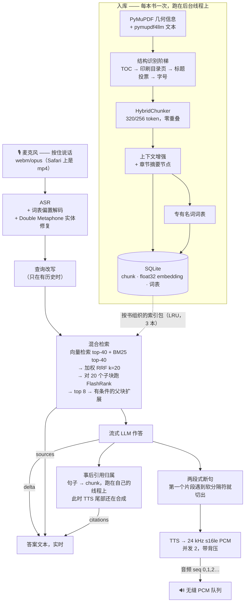

# BookTalk

[English](README.md) · **中文**

上传一本 PDF 书，开口问它一个问题，然后听这本书回答 —— 答案基于书自己的页面，用到的段落
同时显示在屏幕上。有意思的地方不是它能跑通，而是它跑得*多快*、*多诚实*：语言模型还在写
答案的时候，语音就已经开始念了；喂给它的检索是手写的混合检索流水线（结构感知的 chunk、
向量检索 + BM25 融合、5 MB 的 cross-encoder 重排），整个技术栈里没有任何 RAG 框架；本文
里每一个*检索*数字都出自 `backend/eval/` 里的消融实验工具，你可以自己重跑。在一本没人读
过的测试用书上测得：从朴素分块到完整流水线，recall@1 **0.856 → 0.950**；对书里没有答案的
问题，拒答 100% 正确。两个首次出声的数字是例外 —— 从 API 自己的 `first_audio_ms` 计时读
出的 **2.7 s**，以及在浏览器里观察到的 **~3.9 s**，两个都是手工测的，都不来自这套工具。

---

## 它是怎么工作的



值得盯着看的有两处：**TTS 从第一个片段就开始**，不是第一个句子，更不是写完的答案 —— 首
次出声的时间就是从这里来的。以及**引用是在答案已经存在之后才计算的**，不在关键路径上，
所以来源标注不花任何延迟，念出来的文本也永远不会把“(Chapter 7)”读出声。

细节见 [docs/ARCHITECTURE.zh-CN.md](docs/ARCHITECTURE.zh-CN.md)。

---

## 快速开始

Python ≥ 3.9（开发时用的是 macOS 自带的 `python3` 3.9.6）和 Node ≥ 18。

**后端**

```bash
cd backend
python3 -m venv .venv && source .venv/bin/activate
pip install -e '.[dev]'
cp .env.example .env          # then add your OPENAI_API_KEY
uvicorn app.main:app --port 8000
```

**前端**（另开一个终端）

```bash
cd frontend
npm install
npm run dev                   # http://localhost:5173, proxies /api to :8000
```

两边都装好之后，在仓库根目录跑 `./scripts/dev.sh` 可以在一个终端里同时启动两个服务（后端
带 `--reload` 跑在 `:8000`，Vite 跑在 `:5173`），Ctrl-C 一起停掉。

**没有 API key？** `npm run mock` 会在 `:8000` 上启动一个返回预置数据的后端，它实现了完整
的 API 约定 —— 书库、入库进度、SSE 流、PCM 音频 —— 所以 UI 完全可以离线操作。真正的后端
在没有 key 时也能启动：服务照常起来，`/api/health` 上报 `openai_configured: false`，需要模
型的接口返回一个说明清楚该怎么办的 503。

**测试与评测**

```bash
cd backend && .venv/bin/python -m pytest        # 369 offline tests, no network
cd frontend && npm run test && npm run build    # 11 vitest units, zero-error tsc

cd backend
.venv/bin/python eval/make_fixture_book.py      # regenerate the fixture + golden set
.venv/bin/python eval/run_eval.py --fake \
  --report /tmp/fake.md --results /tmp/fake     # offline plumbing check, no key
.venv/bin/python eval/run_eval.py               # the real six-arm ablation
```

`run_eval.py` 默认写入 `eval/report.md` 和 `eval/results/`，所以直接跑 `--fake` 会悄悄用假
数字覆盖掉已提交的真实模型数字 —— 上面那条命令因此加了 `--report`/`--results` 重定向。

---

## 检索真的有效吗？

`backend/eval/` 会生成一本 25 页、12 章的测试用书，内容是一个不存在的群岛；再用写这本书
时依据的同一张事实表派生出 88 个问题，跑六个消融实验分组，每组之间只差一个变量。事实是编
造的，这正是关键：没有模型读过 Kestrel Cove，所以答对说明*检索找到了那段原文*，而不是模
型本来就知道。

真实模型（`gpt-4o-mini` + `text-embedding-3-small`），重排模型
`ms-marco-TinyBERT-L-2-v2`，RRF k=20，权重 0.5/0.5：

| 分组 | 配置 | chunks | recall@1 | recall@3 | recall@5 | MRR | 完整作答 | 拒答正确 |
|---|---|---|---|---|---|---|---|---|
| **A** 朴素 | 固定 800 字符 chunk，仅向量检索 | 85 | 0.856 | 0.938 | 0.950 | 0.929 | 0.925 | 0.943 |
| **B** +结构 | 结构感知的 chunk + 面包屑路径 | 65 | 0.938 | 0.994 | 0.994 | 0.994 | 0.988 | 0.989 |
| **C** +混合 | 向量检索 + BM25，加权 RRF | 65 | 0.950 | 0.988 | 0.994 | 1.000 | 0.975 | 0.977 |
| **D** +重排 | 对融合结果的头部跑 cross-encoder | 65 | 0.950 | 0.975 | 0.994 | 1.000 | 0.975 | 0.977 |
| **E** +摘要 | 章节梗概节点进索引 | 78 | 0.950 | 0.975 | 0.988 | 1.000 | 0.950 | 0.977 |
| **F** +上下文 | 为每个 chunk 生成 LLM 定位上下文 | 78 | 0.950 | 0.975 | 0.994 | 1.000 | 0.963 | 0.977 |

**recall@1 和 MRR 要一起读，否则两个都会读错。**这里的 recall@k 是一个问题的*标准答案章节*
出现在前 k 条里的比例，而 80 道计入检索评分的问题里有 8 道有两个标准答案章节 —— 这种问题
即使第一条结果就是对的，在 k=1 时最高也只能拿 0.5。在 C–F 组里，80 道问题每一道的第 1 位
都是标准答案章节（全部 80 道 `first_rank == 1`，这正是 MRR = 1.000 的含义）；0.950 恰好是
(72 × 1.0 + 8 × 0.5) / 80，而不是漏了四道。C–F 仍然没做到的，是把跨章问题的*第二个*章节也
提上来，剩下的提升空间就在那里。

完整表格 —— token-IoU、分类别拆解、首次命中排名分布、RRF 参数扫描 —— 在
[`backend/eval/report.md`](backend/eval/report.md)，原始 CSV 在 `backend/eval/results/` 下。

### 汇总数字掩盖了什么

表里最没意思的就是汇总那一行。每种技术的作用要看分类别的数字：

- **结构换来的是主题类问题。**“第 7 章讲了什么”没有关键词可以命中。章节摘要类问题的
  recall@1 在 朴素 → +结构 → +混合 之间是 **0.500 → 0.917 → 1.000**，MRR 是
  **0.610 → 0.958 → 1.000**。固定 800 字符的朴素 chunk 完全答不上来；挂在识别出的标题下、
  带面包屑的 chunk 可以。
- **面包屑换来的是跨章综合。**需要检索到两个章节的问题，完整作答率（预期子串全部出现）在
  A 组到 B 组之间从 **0.75 提升到 1.00**，并在 C、D 组保持 1.00。摘要组和上下文增强组吐回
  去了一点（n=8 时 E 组 0.75、F 组 0.875）：正是在这类问题上，摘要节点会和正文 chunk 抢检
  索结果的头部位置。n=8 时一道题就能让数字变动 0.125 —— 逐题的 CSV 已经提交，想看具体案例
  可以直接查。
- **书里没有的问题，每一组都是 8/8 正确拒答。**反过来，实际发布使用的那一组会把 80 道可回
  答问题里的 2 道错误拒答（最好的组是 1 道）。重排模型的置信分数看上去能区分这两种情况 ——
  但只在测试用书的一部分上成立：单一事实类问题 **0.98**、ASR 受损类问题 **0.99**，而书里
  没有的问题是 **0.003–0.038**；同一组里跨章类停在 **0.47**、章节摘要类停在 **0.50**（摘要
  组把章节摘要类拉回到 0.95，跨章类仍然是 0.47）。这本来就比“书内问题 0.98”窄得多，而在真
  实的书上，这个排序直接反了过来：*“第 2 章发生了什么”* —— 由四段引用原文正确作答 —— 只拿
  到 **0.0017**，而书里从未提过的一个主题拿到 **0.9953**。两个方向都错，所以应用里没有用
  它。**警告改成在答案上测量**：事后引用归属会统计答案自己的句子里有多少条能追溯回检索到的
  原文，当一条实质性答案（>80 个字符，这样有意的拒答就不会被算进来）一条都追溯不上时，横幅
  才出现。这个分数仍然在计算，也仍然跟着检索轨迹一起在 `sources` 事件里发出 —— 只是不再决
  定任何事情。
- **ASR 实体修复有效，12/12。**每一个读音被识别错的岛屿名（把 "Kestrel Cove" 听成
  "Castrel Cove"）都在检索开始前，靠从书里采集的词表被准确还原。
- **重排每次查询大约多花 80 ms** —— C 组到 D 组的平均检索时间是 **187 ms → 267 ms**。这是
  两次完整 `retrieve()` 调用之间的差值 —— 包含融合、重排和父块扩展，模型在循环外只加载一
  次 —— 而不是 cross-encoder 单独的开销。下面决策表里写的 **7.6 ms** 是更窄的测量：对 20 段
  原文单独跑一次 `rank()`。两个口径都不贵，但在这个语料上它没有换来 recall（见下）。

### 如实说明的局限

这些比表格更重要：

- **测试用书已经饱和。**25 页、65 个 chunk 是很小的搜索范围：*每一组*（包括朴素组）的
  recall@5 都 ≥0.95，单一事实类问题在朴素分块下 recall@1 就已经是 0.979。B 组之上几乎没有
  空间了。**所以实测到的提升是下限，不是估计值** —— 仍有提升空间的类别（章节摘要、跨章）恰
  好就是流水线提升最多的地方，在一本真实的 400 页书上，这个形态应该会被放大，但这套工具没
  法证明这一点。
- **重排、摘要和上下文增强在这里没有回本。**D、E、F 三组的 recall 相对 C 组持平或略差，而
  D 组每次查询多花约 80 ms。它们此前的理由之一是上面那套置信度区分；那个分数被弃用之后，这
  个理由也没了。剩下的理由是：一本饱和的 25 页测试用书，是衡量一项为大语料设计的技术最糟糕
  的场地 —— 所以它们仍然开着，但仅凭这些证据它们未被证明有效，本文不会声称相反的结论。
- **RRF 参数扫描几乎是平的，但不完全平。**在 k ∈ {10, 20, 60} × 向量检索/BM25 权重分配
  {0.3/0.7, 0.5/0.5, 0.7/0.3} 的九个格子里，recall@1（0.950）、recall@10（1.000）和
  MRR（1.000）全都钉死不动，recall@5 只动了一次（k=60、BM25 偏重，0.994 → 0.988）。**真正
  会动的是 recall@3 这一列**，而且它在每个 k 上给出的权重分配排序都一样：向量检索偏重
  0.994，均衡 0.988–0.994，BM25 偏重 0.975。方向一致，幅度极小 —— 最好到最差是 0.019 的平
  均 recall，大约相当于 80 道有标准答案章节的问题里的一道半。所以 k 在这里确实无关紧要，但
  0.5/0.5 并不是 recall@3 上实测的最优（k=20 时最优是 0.7/0.3，高 0.006 —— 半道题），默认值
  依据的仍然是小语料的推理，而不是这次扫描。这一点之前被写成*没有信号*，原因是
  `report.md` 的扫描表只打印了 recall@1/5/10，恰好跳过了唯一有变化的那一列；
  `results/sweep.csv` 里一直有这一列，现在表里也有了。
- **`--fake` 的数字不是质量数字。**`FakeAIClient` 用 `sha1(text)` 给 embedding 播种，所以向
  量检索按构造就是噪声。`--fake` 跑绿只能证明这套工具能端到端执行，别的什么都证明不了。

---

## 设计决策

### 采纳的，以及原因

| 决策 | 理由 |
|---|---|
| **手写 RAG，不用 LangChain/LlamaIndex** | 检索*就是*被评分的核心。框架会把这个项目需要展示、测试和做消融的那些决策藏起来。从融合到引用归属，全部加起来也就几百行可读的代码。 |
| **分块之前先走结构识别阶梯**（内嵌 TOC → 印刷的目录页 → 标题族投票 → 字号直方图 → 合成兜底） | 知道自己属于哪一章的 chunk 比不知道的更有价值。投票那一层移植自 RAGFlow 的 `bullets_category`。 |
| **用 `pymupdf4llm` 作为文本层** | 在一本真实的 244 页书上测得：直接用 `get_text()` 会留下 129 个连字字符和 68 处行末断词连字符，用 pymupdf4llm 是 **0 和 0**。去掉断词连字符对 BM25 是直接的收益 —— `light-\nhouse` 不是 `lighthouse` 这个 token。我们自己的结构识别通过它的 `hdr_info=` 钩子注入。 |
| **Docling `HybridChunker` 的三遍算法，320/256 token，零重叠** | 用一个有名字、可引用的算法，而不是自己发明一个。零重叠依据的是 Chroma 的分块研究（5 个语料、472 个查询；recursive 200/0 = 88.1% recall，每一个带重叠的分组都更差）。 |
| **打分用小的子块，阅读用大的父块** | 精度和上下文需要的尺寸不一样。检索给 320 token 的子块打分；模型读的是 ≤1600 token 的小节窗口，而且只对分数在最佳命中三分之一以内的 chunk 这么做。 |
| **加权 RRF 用 k=20，不是 60** | k=60 是 Cormack 等人针对百万级文档的 TREC 语料给出的常数。一本书要小四个数量级。评测里扫过：在任何权重分配下 k 都没有改变任何数字，而唯一会动的那一列（recall@3）动的方向对我们的默认值不利 —— 见前面的局限。 |
| **FlashRank cross-encoder**（`ms-marco-TinyBERT-L-2-v2`） | 5 MB 的 ONNX，不依赖 torch，在这台机器上对 20 段原文单独跑一次 `rank()` 是 **~7.6 ms** —— 这跟评测围绕整个 retrieve 调用测出的每次查询 **~80 ms** 差值不是同一个数。任何失败都会退化成融合的排序，而且没有 key 时绝不下载模型。 |
| **事后做引用归属**（RAGFlow 的 `insert_citations`） | 行内的“(Chapter 3)”标记会被*念出来*。事后归属跑在 TTS 尾部旁边的独立线程上，对首次出声延迟零开销，而且是把句子匹配到模型真正看过的 chunk。 |
| **两段式断句 + 裸 PCM** | 第一个片段只要 ≥10 个字符，遇到任何软分隔符就送去 TTS；之后的片段需要真正的句子边界。PCM 省掉了 mp3 解码这一步，并让字节数 == 时长，背压估算就是基于这一点。 |
| **ASR 实体偏置 + Double Metaphone 修复** | 命名实体被识别错造成了 ASR 引发的 RAG 失败中的 87–96%，而一本书是封闭语料，里面的名字我们已经读过。评测里 12/12 全部修复。 |
| **SQLite + numpy，不用向量数据库** | 几万个 chunk 就是一次远不到一毫秒的矩阵-向量乘法。在这里加一个向量数据库，只是多一层用不上的基础设施。 |
| **只有 `AIClient` 一个替换点** | 每一次 OpenAI 调用都走同一个 Protocol。换成 `FakeAIClient`，整条流水线 —— 包括 SSE 流和评测工具 —— 就能离线、确定性地跑起来。 |

### 放弃的，以及原因

把放弃的选项写下来，是因为一个设计同样由它决定不做的事情构成。完整调研和出处见
[docs/RESEARCH.zh-CN.md](docs/RESEARCH.zh-CN.md)。

| 放弃的 | 理由 |
|---|---|
| **LangChain / LlamaIndex** | 抽象会把正在被评分的那些决策藏起来，还会让消融实验分组比流水线本身更难写。 |
| **ragas / deepeval** | 两个在 py3.9 上都能装，但会分别拖进 langchain/datasets/scipy 和 grpcio/otel/posthog 遥测 —— 而且对这个项目需要分辨的那种细小消融差值，LLM 打分是很差的量具。取而代之的全是确定性指标：recall@{1,3,5,10}、MRR、token 级 IoU、预期子串匹配和拒答正确性。SPEC §14.10 还计划过在旁边放一个手写的约 30 行忠实度评判；它从未实现，`backend/eval/` 里没有任何形式的评判器。 |
| **HyDE** | 在*首次出声的关键路径*上多一次完整的 LLM 往返，还会带来实体幻觉 —— 这正是语音流水线最承受不起的失败。 |
| **Late chunking（Jina）** | 在这个技术栈上架构性地做不到：它需要 token 级的 embedding，而 OpenAI 只返回池化后的向量。何况公开的收益也只有 +1.5–1.9 nDCG。 |
| **完整的 RAPTOR** | 入库时跑 UMAP/numba 聚类，只换来 2–3 个点，而且和一棵真实的章节树高度重复。保留了它的退化情况 —— 每章一个摘要节点，加上全书一个 —— 也就是 E 组。 |
| **把语义分块作为主路径** | NAACL 2025（Qu、Tu 和 Bao）和 Chroma 都发现，在真实文档上相对固定尺寸分块，这个开销不划算。 |
| **Tailwind / shadcn / assistant-ui** | shadcn 的默认外观是辨识度最高的那种“AI 模板”样子。Radix 原语提供无障碍行为（焦点锁定、portal、ARIA），不会把那套外观一起带进来。 |

---

## 实测延迟

| | | 数字的来源 |
|---|---|---|
| 首次出声，在 API 侧测量（`first_audio_ms`） | **2.7 s** | 手工测量：从一次真实轮次里读出的 `done` 事件自带的计时。不是评测工具产出的。 |
| 首次出声，在浏览器里观察（包含录音上传、ASR 往返、SSE 传输和 WebAudio 调度） | **~3.9 s** | 在浏览器里对真实轮次手工测量，从录音结束到第一个能听见的采样。不是评测工具产出的。 |
| 平均检索时间，不含重排 | 187 ms | 评测工具，C 组，88 道问题的平均值（`results/per_category.csv`）。 |
| 平均检索时间，含重排 | 267 ms | 评测工具，D 组，同样的 88 道问题。 |

SPEC §1 定的目标是转写完成后 ≤3.5 s 出第一声可听见的音频；API 侧的数字达标，浏览器侧观察
到的数字单独列出而不是并进去，因为这个差距是真实存在的，读者应该两个都看到。两个都是单机
手工测量而不是评测工具的输出，所以它们带了一条检索那两行不需要的来源说明。

---

## 许可与署名

本项目是 MIT。它的依赖和借用的代码并不都是 MIT，这一点很重要：

- **PyMuPDF 和 `pymupdf4llm` 是 AGPL-3.0**（与 Artifex 的商业许可双授权）。AGPL 的义务在
  *分发*时触发，包括通过网络提供服务。这是一份本地运行、既不分发也不作为服务提供的
  take-home 作业，所以当前状态就满足 AGPL 条款 —— 但如果把 BookTalk 作为产品发布，就必须要
  么以 AGPL 开源，要么购买 Artifex 的商业许可。这里明确写出来，而不是藏起来。
- **内置的 LiveKit 断句器** —— `app/speech/sentences.py` 里有一份 LiveKit Agents 基于规则的
  句子分词器的移植（**Apache-2.0**），在文件里那段内置代码处标注了出处。
- **FlashRank** —— Apache-2.0。`onnxruntime` MIT，`semchunk` MIT，`Metaphone` BSD，
  `rank-bm25` Apache-2.0，`jieba` MIT。
- **`.claude/skills/` 下的设计类 skill** 是人工审阅后从开源项目采用的，只有指令文件，没有安
  装任何脚本或 hook：
  [`Leonxlnx/taste-skill`](https://github.com/Leonxlnx/taste-skill)（**MIT**）→
  `minimalist-ui`、`redesign-existing-projects`；
  [`pbakaus/impeccable`](https://github.com/pbakaus/impeccable)（**Apache-2.0**）→
  `impeccable-craft`。出处表格：[`.claude/skills/README.md`](.claude/skills/README.md)。
- **标注出处后借用的算法**（重新实现，不是复制）：RAGFlow（`bullets_category`、
  `assign_toc_levels`、`insert_citations`）、Docling 的 `HybridChunker`、pipecat 的非空白字
  符前瞻、stream2sentence 的片段参数、Anthropic 的 contextual retrieval、kotaemon 的低置信度
  UI 模式。每一项都在调用处和 [docs/ARCHITECTURE.zh-CN.md](docs/ARCHITECTURE.zh-CN.md) 里标
  注了出处。

---

## 局限与下一步

已知，而且是有意为之：

- **扫描版的书会被拒绝，不做 OCR。**上传前的预检会统计前 10 页的每页字符数（原生电子版
  ≈1400+，纯图片 ≈0），不达标就带着明确提示让上传失败。下一步：在同一个预检后面加一层
  OCR —— Tesseract，或者 PyMuPDF 自带的 OCR 桥接 —— 让这个阶梯继续降级，而不是直接停住。
- **只有按住说话，没有免手动模式。**浏览器端 VAD（`@ricky0123/vad-web`）暂时放弃了：首屏要
  多加载约 4.8 MB，而且在 iOS 上和打断说话上都还有未解决的问题。下一步：在 `recorder.ts` 里
  做一个基于 RMS 的端点检测，它的 `start`/`stop` API 当初就是按“能被包一层而不用改调用方”来
  设计的。
- **一次对话只针对一本书。**索引包、检索和引用都是按书组织的。多书（“问我的书架”）需要在检
  索之前加一步选书，还需要一套跨书的融合策略 —— 这是一个真正的设计问题，不是加个循环。
- **服务端没有拒答闸门。**拒答来自作答的 prompt（在测试用书上两个方向都 100% 正确），而 UI
  上的依据不足横幅是事后检查 —— 它需要写完的答案，所以按构造就不可能阻止一个答案被生成。一
  个能跳过生成的闸门，需要一个在答案存在*之前*就拿得到的信号，最明显的候选是检索置信分数，
  而它恰好是被测出两个方向都错的那个信号。这不是加个开关的事，是一个研究问题。
- **没有鉴权、没有部署、没有深色模式。**按 SPEC §12 属于范围外。

---

## 文档

| | |
|---|---|
| [SPEC.zh-CN.md](SPEC.zh-CN.md) | 有约束力的技术契约，写在任何代码之前。§14 是基于调研的 v2 修订。 |
| [docs/ARCHITECTURE.zh-CN.md](docs/ARCHITECTURE.zh-CN.md) | 流水线的细节：入库阶梯、分块、检索、引用、语音、存储。 |
| [docs/TESTING.zh-CN.md](docs/TESTING.zh-CN.md) | 369 个离线测试覆盖了什么（326 个单元 + 43 个集成，另加 11 个前端 vitest 单元测试）、怎么跑、评测工具，以及一份手工 E2E 检查清单。 |
| [docs/AI_WORKFLOW.zh-CN.md](docs/AI_WORKFLOW.zh-CN.md) | 这个项目是怎么用 AI agent 做出来的 —— 过程记录，包括哪里出过问题。 |
| [docs/RESEARCH.zh-CN.md](docs/RESEARCH.zh-CN.md) | 开源调研的那一轮：采用了什么、从哪里来、放弃了什么。 |
| [backend/eval/README.zh-CN.md](backend/eval/README.zh-CN.md) | 测试用书、问题集、各个分组和指标。 |
| [backend/eval/make_real_book.py](backend/eval/make_real_book.py) | 一个命令行工具：抓取 Project Gutenberg 上的公有领域书籍，剥掉许可声明外壳，找出章节分界，把前 12 个完整章节排版成一个带内嵌大纲的 PDF。测试用书是刻意编造的；真实的书是这样造出来的，用来在没人为它写过的文本上检验入库阶梯。 |
| [frontend/DESIGN.zh-CN.md](frontend/DESIGN.zh-CN.md) · [frontend/DESIGN-SHELF.zh-CN.md](frontend/DESIGN-SHELF.zh-CN.md) | UI 是照着这两份设计说明做的：“Studio Light”浅色表面体系（v3，第三个方向），以及挡在对话前面的书架落地页。前端的视觉决策在这里论证，包括某份设计说明在哪些地方刻意覆盖了某个设计 skill。 |
